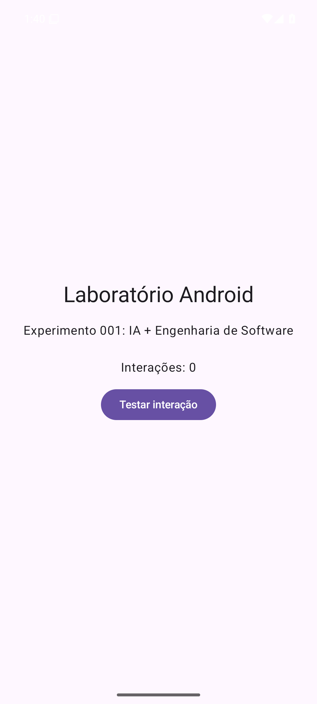
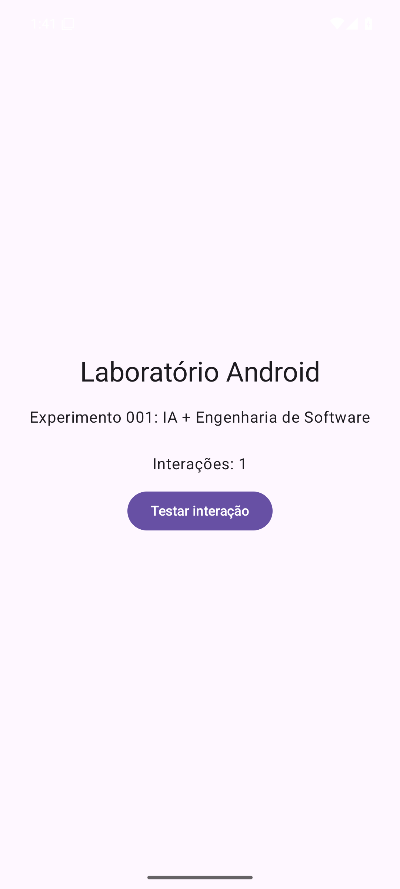

# Experimento 002 — Resultado: Android virtual sem celular físico

**Data:** 2026-11-03
**Resultado:** BUILD_ENTREGUE / TESTE_EMULADOR_APROVADO / EVIDENCIA_PUBLICADA.
**Autorização humana:** LEANDRO autorizou implementar e executar o workflow gratuito no repositório público.
**Orquestração:** MESTRE. Esta execução foi coordenada nesta conversa; não afirma ativação do runtime persistente MCF nem agentes independentes.

## Objetivo e implementação
- Compilar o aplicativo Kotlin/Jetpack Compose e o APK de teste de instrumentação.
- Inicializar Android Emulator API 35 (Android 15), x86_64, usando KVM no runner GitHub Actions ubuntu-latest.
- Executar teste Compose para conferir tela e contador inicial 0, tocar no botão e confirmar contador 1.
- Confirmar novamente por ADB, capturar screenshots reais antes e depois e preservar XML JUnit.

## Execução aprovada
- Repositório: https://github.com/leon337/android-lab-001
- Commit efetivamente testado: `6ff1b5eb3ce28e5bf1cfb01eaedebf4dcc1aee6f`
- GitHub Actions Run: https://github.com/leon337/android-lab-001/actions/runs/41645894895
- Run ID: `41645894895`; status `completed`, conclusão `success`.
- Job `teste-android`: `success`, 4m32s.
- Etapas principais: KVM, Java, Android SDK, Gradle, build do APK, emulador, teste e upload de evidências, todas `success`.
- Artefato GitHub Actions: `android-lab-001-emulador-evidencias` (ID `13235521158`, retenção configurada de 1 dia).
- XML JUnit: `tests=1`, `failures=0`, `errors=0`, `skipped=0`.
- Dispositivo de teste: `emulator-5554 - 15`.

## Capturas reais do emulador
| Etapa | Imagem | Estado verificado | SHA-256 |
|---|---|---|---|
| Antes | [contador-antes.png](evidencias/experimento-002/contador-antes.png) | Interações: 0 | `95e981146e7f4543eff002836b2541593d96d34fd8f5f237990397a33cc1c156` |
| Depois | [contador-depois.png](evidencias/experimento-002/contador-depois.png) | Interações: 1 | `37ad95d082096be133ebfcd9cc8576cf85b7f18de356293e4b2a1c9c94e4f6f6` |

Imagens 1080 × 2400 pixels geradas por `adb exec-out screencap -p`. Resultados de tela também verificados via XML do UI Automator. Ver [JUnit XML](evidencias/experimento-002/teste-contador-junit.xml).

### Prévia

## CAF — Recuperação de falhas
1. Primeiro run `41645020374` compilou APK e executou **1 teste Compose com sucesso**, mas falhou ao tentar extrair capturas do diretório de dados do app após o teste.
2. Falha observada no log: `ls: /sdcard/Android/data/br.com.laboratorio.android/files/Pictures/laboratorio: No such file or directory`.
3. Corrigido o script de evidências para reinstalar e abrir o APK via ADB, inspecionar a UI real, encontrar coordenadas do botão, tocar e capturar imagens de tela antes/depois por `screencap`.
4. Segundo run `41645894895`, commit `6ff1b5e`: todos os passos passaram. Evidências e XML baixados e inspecionados.

## Estado e próximos passos
- Critérios de aceite do Experimento 002: **atingidos**, sem celular físico.
- Workflow permanece de acionamento manual; nenhuma execução periódica automática foi configurada.
- Não foram ativados serviços pagos.
- MBC utilizado para abrir GitHub Actions no Brave e acionar manualmente os dois workflows via interface web.
- Próximo HUMAN_GATE: LEANDRO revisa visualmente as duas capturas e define a evolução do aplicativo.
