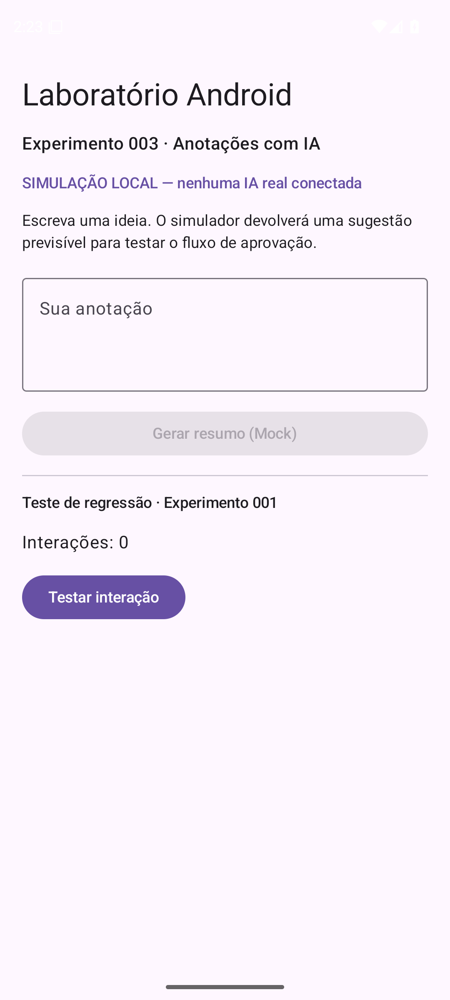
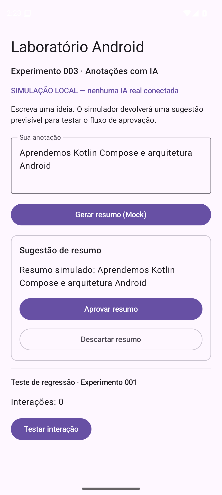
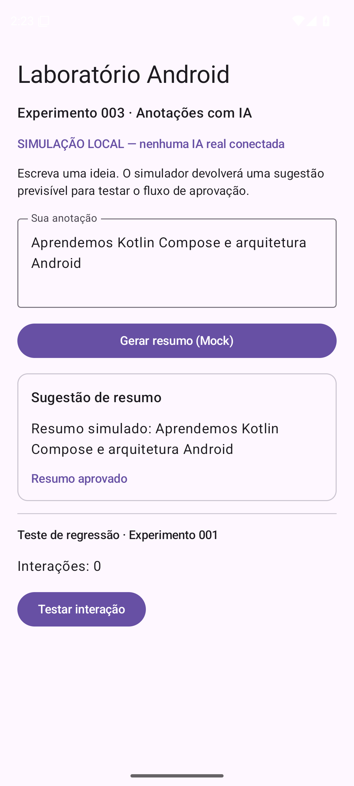

# Experimento 003 — Fase A — Relatório de execução e evidências

**Data:** 2026-11-03
**Missão:** ANDROID-LAB-003, fase A
**Estado:** IMPLEMENTADO / COMPILADO / TESTADO_EM_EMULADOR / APROVADO_TECNICAMENTE / REVISÃO_HUMANA_PENDENTE
**Autoridade humana final:** LEANDRO.
**Coordenação:** MESTRE, nesta conversa e com ferramentas conectadas. Não há alegação de execução de runtime MCF persistente ou atuação real de agentes independentes.

## Escopo e proteção do HUMAN_GATE
- Solicitado e autorizado: Kotlin, Compose, ViewModel, AIRepository, Mock local, fluxo de aprovação e descarte, build/teste gratuitos na nuvem, MBC.
- Expressamente proibido até autorização separada: Firebase, Gemini real, API externa, credenciais, projetos de nuvem e faturamento.
- Verificação: nenhuma integração Firebase ou token foi adicionada. O Mock não executa inferência nem rede.
- Contrato: [plano da fase](EXPERIMENTO-003-FASE-A-PLANO.md).

## Arquitetura
`Jetpack Compose -> NotesViewModel (StateFlow/viewModelScope) -> AIRepository -> MockAIRepository`.
- A tela recebe entrada, exibe carregamento/erro/resultado, permite aprovar ou descartar a sugestão.
- `NotesViewModel` controla os estados imutáveis do fluxo de anotações.
- `AIRepository` é o contrato; `MockAIRepository` retorna sugestão determinística com delay local.
- O contador do Experimento 001 permanece como teste de regressão.
- A interface exibe a identificação: "SIMULAÇÃO LOCAL — nenhuma IA real conectada".

## Evidências de execução final
- Repositório: https://github.com/leon337/android-lab-001
- Commit exato do aplicativo e workflow testados: `5e9ca8dcf851e60de179c6a4a577268ec964d86c`.
- Workflow: https://github.com/leon337/android-lab-001/actions/runs/41652674671
- Run: `41652674671`; status `completed`, conclusão `success`.
- Job `teste-android`: `success`, duração `3m42s`.
- Steps: KVM, SDK, Java, Gradle, build APK + APK de teste, Android virtual, JUnit Compose, interação ADB e upload: aprovados.
- Ambiente: emulador Android 15 (API 35), x86_64, runner `ubuntu-latest` no repositório público.
- Relatório JUnit: **3 testes, 0 falhas, 0 erros, 0 ignorados**, 20.2 segundos (casos abaixo).
- Artefato do GitHub Actions: `android-lab-001-emulador-evidencias`, ID `13238552036`, retenção temporária configurada de 1 dia. Capturas e XML preservados no Git.

### Casos de teste
1. `contadorMostraEstadoInicialEIncrementaAposClique` — regressão do contador.
2. `criarResumoMockEAprovar` — entrada de anotação, geração de sugestão e aprovação.
3. `descartarResumoVoltaAoEstadoSemSugestao` — descarte da sugestão.

[XML JUnit verificado](evidencias/experimento-003/testes-compose-junit.xml).

## Capturas reais do Android virtual
- [Tela inicial](evidencias/experimento-003/app-inicial.png): formulário e aviso de IA simulada, com afastamento correto da barra de status.
- [Resumo sugerido](evidencias/experimento-003/resumo-sugerido.png): texto do Mock e opções de aprovar ou descartar.
- [Resumo aprovado](evidencias/experimento-003/resumo-aprovado.png): estado "Resumo aprovado".

Todas são PNGs 1080x2400 produzidas no emulador via `adb exec-out screencap -p`, com verificações de estado pela hierarquia de acessibilidade.

| Imagem | SHA-256 |
|---|---|
| app-inicial.png | `1c5afea080a8a13b30be3a8072e7b7e32929874e55172d38ddcf61586cee3e95` |
| resumo-sugerido.png | `910cbdf4989f24b4ebd9eb05b6f1537f22e1147f2f910c208e9f86ab5b55b9c4` |
| resumo-aprovado.png | `c6b8b49dcc638a11caaf352e55aff9c6ed31c3b826a1a1c7f8f6805b1ba61381` |

## CAF — Ciclos de recuperação
1. Run `41650062041` (commit `2b1106f`): falha em compilação dos testes por import Compose `onAllNodesWithTag` ausente; o emulador não foi executado nessa tentativa.
2. Run `41650508725` (commit `ce8f081`): **3 testes Compose e execução ADB aprovados**, screenshots capturadas; inspeção visual revelou título próximo à barra de status.
3. Run `41651534023` (commit `e486f04`): após `safeDrawingPadding`, 3 testes Compose passaram, mas a captura ADB foi bloqueada por diálogo do launcher do emulador ("Pixel Launcher isn't responding"); evidência no XML da UI.
4. Run `41652674671` (commit `5e9ca8d`): rotina ADB passa a verificar a tela pronta e a tratar o aviso "Wait" antes de capturar; **resultado final totalmente aprovado**.

## MBC e rastreabilidade
- Navegação e disparos feitos pelo MBC no Brave com `browser_navigate`, `browser_snapshot` e `browser_click`, usando a interface do GitHub.
- A inspeção de logs, downloads dos artefatos e verificações de XML/PNG foram feitas por terminal remoto complementar.
- Nenhuma ação de configuração de Firebase foi executada.

## Próximo HUMAN_GATE
Revisão visual humana das capturas e aprovação expressa da preparação da Fase B. Nenhum projeto Firebase, token ou credencial poderá ser criado sem nova autorização.
